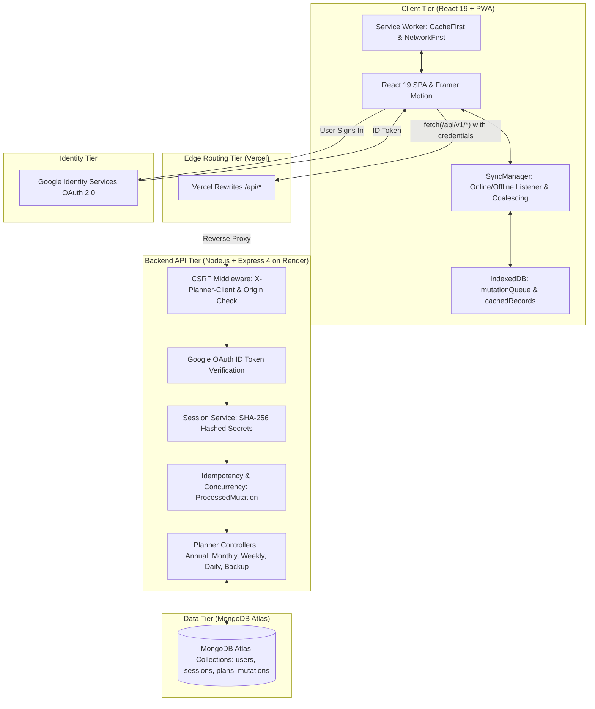

# Guided Annual Planner & Personal Growth Sanctuary

[](https://guided-annual-planner.vercel.app/)
[](https://guided-annual-planner.onrender.com/health)
[](https://github.com/petersisay/guided-annual-planner)
[](https://github.com/petersisay/guided-annual-planner)
[](package.json)

A modern full-stack web application and Progressive Web App (PWA) inspired by physical guided journals created in Ethiopia. Built to eliminate blank-page paralysis, cultivate daily focus, and transform micro-habits into long-term compounding progress.

> *"Doing small things before taking major steps compounds over time to create a huge impact."*

---

## Table of Contents

- [Live Demo & Repository](#live-demo--repository)
- [Application Screenshots](#application-screenshots)
- [Key Features](#key-features)
  - [1. Annual Horizon Spread](#1-annual-horizon-spread)
  - [2. Monthly Intentions Spread](#2-monthly-intentions-spread)
  - [3. Weekly 7-Day Planner](#3-weekly-7-day-planner)
  - [4. Daily Focus & Evening Journal](#4-daily-focus--evening-journal)
  - [5. Habit & Mood Consistency Trackers](#5-habit--mood-consistency-trackers)
  - [6. Offline-First PWA Synchronization](#6-offline-first-pwa-synchronization)
  - [7. Complete JSON Backup & Restore](#7-complete-json-backup--restore)
- [Technology Stack](#technology-stack)
- [System Architecture](#system-architecture)
- [Project Directory Structure](#project-directory-structure)
- [Prerequisites](#prerequisites)
- [Installation & Local Setup](#installation--local-setup)
- [Environment Variables](#environment-variables)
- [Authentication & Security Model](#authentication--security-model)
- [Offline Synchronization & Conflict Handling](#offline-synchronization--conflict-handling)
- [Backup, Portability & Emergency Recovery](#backup-portability--emergency-recovery)
- [Automated Testing & Production Build](#automated-testing--production-build)
- [Production Deployment](#production-deployment)
- [Troubleshooting](#troubleshooting)
- [Contributing](#contributing)
- [License](#license)
- [Author & Acknowledgments](#author--acknowledgments)

---

## Live Demo & Repository

- **Production Frontend**: [https://guided-annual-planner.vercel.app/](https://guided-annual-planner.vercel.app/)
- **Production Backend Health Check**: [https://guided-annual-planner.onrender.com/health](https://guided-annual-planner.onrender.com/health)
- **GitHub Repository**: [https://github.com/petersisay/guided-annual-planner](https://github.com/petersisay/guided-annual-planner)

---

## Application Screenshots

The user interface uses paper-journal design tokens, spiral-bound notebook margins, serif typography, and tactile status indicators:

| View | Description | File Path |
| :--- | :--- | :--- |
| **Annual Horizon** | 12-month calendar cards, yearly theme, intentions, and retrospective review | `reference_images/Screenshot 2026-10-14 122526.png` |
| **Monthly Intentions** | Must-Do checklists, habits, To-Buy card, 5-book reading shelf, and reflections | `reference_images/Screenshot 2026-10-14 122649.png` |
| **Weekly Planner** | 7-day overview with Rule of 3 priorities and weekly retrospective | `reference_images/Screenshot 2026-10-14 122758.png` |
| **Daily Spread** | Top 3 priorities, secondary tasks, hourly schedule blocks, and 4-part journal | `reference_images/Screenshot 2026-10-14 122831.png` |
| **Habit & Mood Heatmaps** | GitHub-style consistency heatmaps calculating annual habit and emotional trends | `reference_images/Screenshot 2026-10-14 122958.png` |
| **Settings & Backup** | Weekly start preference, appearance settings, JSON backup export, and schema validation preview | `reference_images/Screenshot 2026-10-14 123051.png` |

---

## Key Features

### 1. Annual Horizon Spread (`/annual`)
- **Yearly Theme / Word**: Anchor your year to a single guiding intention (e.g. *Resilience*, *Focus*, *Compounding*).
- **Core Intentions**: Document top 3–5 milestone goals across personal, professional, and health horizons.
- **Year-in-Review Retrospective**: Structured prompts for celebrations, obstacles encountered, and key lessons learned.
- **12-Month Calendar Grid**: Fast navigation to any month with automatic leap-year handling.

### 2. Monthly Intentions Spread (`/monthly/:year/:month`)
- **Dashboard Mode**:
  - **Top 6 Must-Do's**: Monthly non-negotiables with status checkboxes.
  - **5 New Habits**: High-leverage behavioral routines to build.
  - **To-Buy Card**: Sage green inventory list for monthly equipment and reading purchases.
  - **Interactive Bookshelf**: 5 book slots with custom spine titles, authors, completion toggles, and hex-coded spine colors.
  - **Self-Change Reflection**: Guided open-ruled space for personal mental models to unlearn.
- **Calendar Grid Mode**: 35-day grid spread with click-to-edit modal notes for any day.
- **Trackers Mode**: Monthly view of your annual habit completion and mood distribution.

### 3. Weekly 7-Day Planner (`/weekly/:year/:week`)
- **ISO 8601 Calendar Navigation**: Jump seamlessly between weeks 1 through 52/53.
- **Rule of 3 Priorities**: Focus each week on the three highest-impact milestones.
- **7-Day Grid**: Individual daily task slots respecting user week-start preferences (Monday or Sunday).
- **Weekly Retrospective**: End-of-week review notes.

### 4. Daily Focus & Evening Journal (`/daily`)
- **The Rule of 3 (Primary Priorities)**: Limit your essential daily commitments to exactly three items.
- **Additional Tasks**: Secondary checklist with inline creation and deletion.
- **Hourly Schedule Blocks**: Configurable time slots (e.g. `07:00`, `09:30`, `14:00`) with activity descriptions and completion toggles.
- **Structured 4-Part Evening Journal**:
  1. *Gratitude*: 3 distinct ruled prompts.
  2. *Daily Wins*: Celebrating small victories.
  3. *Challenges & Lessons*: Reframing friction into growth.
  4. *Free Writing*: Open reflective space.

### 5. Habit & Mood Consistency Trackers
- **Habit Consistency Heatmap**: Full-year visual grid measuring daily routine completion with color-intensity scaling.
- **Mood Trends**: Track daily emotional wellbeing across 5 calibrated states (*radiant*, *calm*, *neutral*, *low*, *difficult*).

### 6. Offline-First PWA Synchronization
- **Zero-Latency Optimistic UI**: Changes update your screen instantly while saving in the background.
- **IndexedDB Mutation Queue**: When offline, edits are queued in local IndexedDB storage (`mutationQueue`) and debounced to prevent duplicate network requests.
- **Mutation Coalescing**: Multiple edits to the same spread while offline are merged into a single consolidated payload.
- **Optimistic Concurrency Control**: Uses `updatedAt` / `expectedUpdatedAt` timestamps to catch cross-device conflicts (`HTTP 409 CONCURRENT_MODIFICATION_CONFLICT`).
- **Idempotency Protection**: Every mutation carries a unique `X-Mutation-Id` tracked in the database to prevent duplicate writes during network retries.
- **Interactive Conflict Resolver**: One-click resolution modal (`GlobalConflictModal`) lets users choose between keeping offline edits, using the cloud version, or downloading a rescue JSON backup.

### 7. Complete JSON Backup & Restore
- **Zero Lock-In Export**: Download your entire planner history (annual, monthly, weekly, daily, habits, moods, preferences) as an open JSON file at any time.
- **Zod Schema-Validated Import**: Uploaded backup files are parsed and validated against shared schemas before any records touch the database.
- **Pre-Restore Preview**: Inspect total counts of plans and habits before confirming restoration.
- **Strict Tenant Isolation**: Restores are scoped exclusively to the currently authenticated user session.

---

## Technology Stack

```
Frontend:            React 19, TypeScript, Vite, Tailwind CSS, Framer Motion, Lucide React
Backend:             Node.js, Express 4, TypeScript, Mongoose 8
Database:            MongoDB Atlas (M0 Replica Set) with compound unique indexes & TTL
Authentication:      Google Identity Services, google-auth-library, Secure HttpOnly Cookies
State & Sync:        React Context, IndexedDB (idb), Custom SyncManager, Service Workers
Validation:          Zod 3 (shared contract layer between client and server)
Testing:             Vitest 3.2, React Testing Library, Supertest (197 automated tests)
Deployment & Infra:  Vercel (Frontend edge), Render (Backend Web Service), MongoDB Atlas
```

---

## System Architecture

The monorepo uses npm workspaces with zero API contract drift:



---

## Project Directory Structure

```
guided-annual-planner/
├── .env.example                  # Template environment variables for local development
├── package.json                  # Root npm workspaces configuration (shared, server, client)
├── tsconfig.json                 # Root TypeScript base compiler configuration
├── vercel.json                   # Vercel deployment rewrites and build definitions
├── render.yaml                   # Render Blueprint for Node.js web service deployment
├── DEPLOYMENT.md                 # Full production operations & runbook documentation
├── reference_images/             # UI reference screenshots
│
├── shared/                       # Workspace: @planner/shared
│   ├── src/
│   │   ├── types/                # User, Planner, Habit, Mood, Sync, and Backup types
│   │   ├── schemas/              # Zod validation schemas (auth, backup, user, planner)
│   │   ├── utils/                # ISO week calculations, leap year & calendar date math
│   │   └── index.ts              # Canonical barrel exports
│   └── package.json
│
├── server/                       # Workspace: @planner/server
│   ├── src/
│   │   ├── config/               # env.ts (Zod-validated environment), db.ts (Mongoose)
│   │   ├── models/               # User, Session, AnnualPlan, MonthlyPlan, WeeklyPlan, DailyPlan, ProcessedMutation
│   │   ├── services/             # googleAuth.service.ts, session.service.ts
│   │   ├── middleware/           # auth.middleware.ts, csrf.middleware.ts, error.middleware.ts
│   │   ├── controllers/          # auth, annual, monthly, weekly, daily, tracker, user, backup
│   │   ├── routes/               # Express routers for /api/v1/*
│   │   ├── app.ts                # Express application factory with Helmet, CORS, and CSRF
│   │   └── index.ts              # Production cluster entry point
│   └── package.json
│
└── client/                       # Workspace: @planner/client
    ├── src/
    │   ├── components/
    │   │   ├── annual/           # YearCalendarGrid
    │   │   ├── monthly/          # MonthlyDashboard, MonthlyCalendarGrid, BookModal
    │   │   ├── weekly/           # WeeklyTaskList, WeeklyNotes
    │   │   ├── daily/            # DailyPrioritiesAndTasks, DailyScheduleBlocks, DailyJournal
    │   │   ├── journal/          # CircleCheckbox, RuledInput, Bookshelf, SpiralBinding
    │   │   ├── layout/           # PlannerLayout (responsive sidebar, sync indicators, user menu)
    │   │   └── common/           # GlobalConflictModal, HowItWorksModal, SaveStatusBadge
    │   ├── context/              # AuthContext.tsx
    │   ├── hooks/                # usePlanAutosave.ts (optimistic updates, debounced save)
    │   ├── services/             # syncManager.ts (IndexedDB replay, online/offline lifecycle)
    │   ├── utils/                # offlineDb.ts, localStorageBackup.ts, pwa.ts
    │   ├── pages/                # HomePage, LoginPage, OnboardingPage, Annual, Monthly, Weekly, Daily, Settings
    │   ├── styles/               # index.css (paper-journal textures, dot-grid)
    │   ├── App.tsx               # Lazy-loaded routes, ProtectedRoute, ServiceWorker update banner
    │   └── main.tsx              # React 19 root mount
    └── package.json
```

---

## Prerequisites

- **Node.js**: v18.0.0 or later (tested on Node v20, v22, and v24)
- **npm**: v9.0.0 or later (npm workspaces support required)
- **MongoDB**: Local MongoDB instance (`mongodb://127.0.0.1:27017/guided_planner`) or MongoDB Atlas URI
- **Google Cloud Console OAuth 2.0 Web Client ID** (for Google Sign-In)

---

## Installation & Local Setup

### 1. Clone the Repository
```bash
git clone https://github.com/petersisay/guided-annual-planner.git
cd guided-annual-planner
```

### 2. Install Workspace Dependencies
```bash
npm install
```

### 3. Configure Environment Variables
Create `.env` files in both `server/` and `client/` by copying the root `.env.example`:

```bash
# In server/.env
PORT=5000
NODE_ENV=development
CLIENT_ORIGIN=http://localhost:5173
MONGODB_URI=mongodb://127.0.0.1:27017/guided_planner
SESSION_SECRET=dev_secret_key_minimum_32_characters_long_for_hmac_sha256
COOKIE_NAME=planner_session
COOKIE_SECURE=false
GOOGLE_CLIENT_ID=your_google_client_id.apps.googleusercontent.com
```

```bash
# In client/.env
VITE_API_BASE_URL=http://localhost:5000/api/v1
VITE_GOOGLE_CLIENT_ID=your_google_client_id.apps.googleusercontent.com
```

### 4. Build the Shared Workspace
```bash
npm run build:shared
```

### 5. Start Development Servers
In two separate terminals:

```bash
# Terminal 1: Backend API Server (starts on http://localhost:5000)
npm run dev:server

# Terminal 2: Frontend Client (starts on http://localhost:5173)
npm run dev:client
```

Open [http://localhost:5173](http://localhost:5173) in your browser.

---

## Environment Variables

### Backend (`server/.env`)

| Variable | Required | Default | Description |
| :--- | :---: | :--- | :--- |
| `NODE_ENV` | Yes | `development` | Set to `production` in live environments. Enforces `COOKIE_SECURE=true` and locks down `/dev-login`. |
| `PORT` | No | `5000` | Port for the Express API server. |
| `CLIENT_ORIGIN` | Yes | `http://localhost:5173` | Exact frontend HTTPS origin for strict CORS and CSRF validation. |
| `MONGODB_URI` | Yes | `mongodb://127.0.0.1:27017/guided_planner` | MongoDB Atlas cluster connection string with TLS/SSL enabled. |
| `SESSION_SECRET` | Yes | *(minimum 32 chars)* | Cryptographic key used to compute HMAC-SHA256 session tokens. Server fails to boot if default key is used in production. |
| `COOKIE_NAME` | No | `planner_session` | Name of the session cookie. |
| `COOKIE_SECURE` | Yes | `false` | Must be `true` in production to enforce HTTPS cookie transmission. |
| `GOOGLE_CLIENT_ID`| Yes | — | Google Cloud OAuth 2.0 Web Client ID used for token verification. |

### Frontend (`client/.env`)

| Variable | Required | Default | Description |
| :--- | :---: | :--- | :--- |
| `VITE_API_BASE_URL` | No | `http://localhost:5000/api/v1` | Base URL for API requests. On production with Vercel rewrites, defaults to `/api/v1`. |
| `VITE_GOOGLE_CLIENT_ID`| Yes | — | Google Cloud OAuth 2.0 Web Client ID rendered in the Google Sign-In button. Must match the server value. |

---

## Authentication & Security Model

1. **Google ID Token Signature Verification**:
   The frontend requests an OpenID Connect ID token via Google One Tap / Identity Services. The backend directly verifies the token signature against Google's public keys via `google-auth-library`. No client secrets are stored on the client.
2. **Database-Backed Sessions with SHA-256 Hashes**:
   Instead of stateless JWTs that cannot be revoked immediately, session secrets are stored in MongoDB as SHA-256 hashes. Logging out revokes the session in the database instantly.
3. **HttpOnly, SameSite Cookie Enforcement**:
   Session tokens are stored exclusively in `HttpOnly`, `SameSite=Lax`, and `Secure` cookies. JavaScript cannot access tokens, protecting against XSS.
4. **Custom CSRF Defense**:
   All state-changing requests (`POST`, `PUT`, `DELETE`) require the `X-Planner-Client: WebApp` custom header and validate the `Origin`/`Referer` header against `CLIENT_ORIGIN`.
5. **Strict Rate Limiting**:
   Authentication endpoints enforce rate-limiting via `express-rate-limit` (15 attempts per 15 minutes) to protect against brute-force abuse.

---

## Offline Synchronization & Conflict Handling

The application operates as a Progressive Web App (PWA) with full offline support:

```
[User Edits Spread]
        │
        ▼
[Optimistic UI Update] ──▶ Update React State Instantly
        │
        ├──▶ Online? ──▶ Send PUT /api/v1/planner/* with expectedUpdatedAt
        │                  │
        │                  ├── 200 OK: Persist to IndexedDB cachedRecords
        │                  └── 409 Conflict: Open Global Conflict Resolution Dialog
        │
        └──▶ Offline? ──▶ Enqueue in IndexedDB mutationQueue (Coalesced per Entity)
                           │
                           ▼
              [Internet Reconnects ('online')]
                           │
                           ▼
              [SyncManager Replays Queue] ──▶ Sends pending mutations sequentially
```

- **Mutation Coalescing**: If you edit multiple checklist items while offline, the app updates the single existing queued mutation in IndexedDB rather than queueing conflicting requests.
- **Conflict Handling**: When a conflict occurs (`HTTP 409`), users are presented with clear choices:
  - **Keep My Offline Changes**: Unconditionally overwrites the cloud with local offline work.
  - **Keep Cloud Version**: Discards the local offline changes and downloads the cloud record.
  - **Download Backup**: Exports unsynced mutations to a `.json` file for emergency safekeeping.

---

## Backup, Portability & Emergency Recovery

- **Exporting a Backup**:
  Navigate to **Settings & Backup** (`/settings`) &rarr; Click **"Download Complete Backup"**. The server packages all user documents into a validated JSON archive (`guided-annual-planner-backup-[DATE].json`).
- **Restoring a Backup**:
  Drag or select your `.json` backup file &rarr; Inspect the preview modal (counts of plans, habits, and preferences) &rarr; Click **"Confirm & Restore"**. The server validates the payload with Zod before applying it transactionally to your account.
- **Emergency Unsynced Recovery**:
  If network errors ever persist, click **"Download Rescue Backup"** in the sidebar or logout guard modal. This calls `syncManager.exportUnsyncedData(userId)`, saving queued IndexedDB mutations directly to your device.

---

## Automated Testing & Production Build

The repository features comprehensive automated test coverage across all layers:

```bash
# Run all 197 tests across shared, server, and client workspaces
npm test

# Run tests by workspace
npm run test:shared    # 3 test files, 20 passed (Zod schemas & calendar math)
npm run test:server    # 10 test files, 90 passed (Controllers, sessions, concurrency, CSRF)
npm run test:client    # 20 test files, 87 passed (UI components, IndexedDB, sync manager)
```

### Production Build Command
To build all workspaces in topological order:
```bash
npm run build
```
This executes:
1. `npm run build:shared` &rarr; Compiles TypeScript definitions to `shared/dist/`.
2. `npm run build:server` &rarr; Compiles Express server to `server/dist/`.
3. `npm run build:client` &rarr; Compiles Vite React PWA bundle to `client/dist/`.

---

## Production Deployment

The live system uses a decoupled cloud architecture:

- **Frontend (Vercel)**:
  - Connected to GitHub branch `main`.
  - Build command: `npm run build:shared && npm run build:client`
  - Output directory: `client/dist`
  - Rewrites `/api/:path*` and `/health` to Render backend API via [vercel.json](vercel.json).
- **Backend (Render Web Service)**:
  - Connected to GitHub branch `main`.
  - Build command: `npm install --include=dev && npm run build:shared && npm run build:server`
  - Start command: `npm run start --workspace=server`
  - Environment: `NODE_ENV=production`, `PORT=5000`, `CLIENT_ORIGIN=https://guided-annual-planner.vercel.app`, `COOKIE_SECURE=true`.
- **Database (MongoDB Atlas)**:
  - M0 cluster replica set with TLS connection string (`mongodb+srv://...`).

For step-by-step zero-downtime deployment, environment variable configuration, and rollback strategies, see [DEPLOYMENT.md](DEPLOYMENT.md).

---

## Troubleshooting

### 1. Google Sign-In Fails with "Origin Mismatch" (Error 400)
- **Cause**: The current domain or port is not listed under Authorized JavaScript Origins in Google Cloud Console.
- **Solution**: Open [Google Cloud Console](https://console.cloud.google.com/) &rarr; APIs & Services &rarr; Credentials &rarr; Edit OAuth 2.0 Web Client ID. Add both:
  - `http://localhost:5173` (for local development)
  - `https://guided-annual-planner.vercel.app` (for production)

### 2. "CSRF_FORBIDDEN: Untrusted request origin"
- **Cause**: `CLIENT_ORIGIN` in `server/.env` does not match the frontend domain making requests.
- **Solution**: Ensure `CLIENT_ORIGIN` in server configuration matches your frontend URL exactly (e.g. `http://localhost:5173` locally, or `https://guided-annual-planner.vercel.app` in production). Do not include a trailing slash.

### 3. Server Startup Fails with "SESSION_SECRET cannot use default key"
- **Cause**: `NODE_ENV` is set to `production`, but `SESSION_SECRET` was left as the default development string.
- **Solution**: Generate a random string of 32+ characters (e.g. `openssl rand -hex 32`) and set it as `SESSION_SECRET`.

### 4. Client Cannot Connect to Backend Locally
- **Cause**: Backend server is not running or running on an unexpected port.
- **Solution**: Verify backend is active by visiting `http://localhost:5000/health`. Confirm `VITE_API_BASE_URL=http://localhost:5000/api/v1` in `client/.env`.

---

## Contributing

Contributions, feedback, and issue reports are welcome!

1. Fork the repository on GitHub.
2. Create a feature branch:
   ```bash
   git checkout -b feature/my-new-feature
   ```
3. Commit your changes with clear [Conventional Commits](https://www.conventionalcommits.org/):
   ```bash
   git commit -m "feat(monthly): add export button for bookshelf reading list"
   ```
4. Run the full test suite to guarantee zero regressions:
   ```bash
   npm test
   ```
5. Push to your branch and open a Pull Request.

---

## License

This repository's `package.json` specifies the **ISC License**. A standalone `LICENSE` file is not yet included in the root directory.

---

## Author & Acknowledgments

- **Author**: Petros Sisay ([@petersisay](https://github.com/petersisay))
- **Live Application**: [https://guided-annual-planner.vercel.app/](https://guided-annual-planner.vercel.app/)
- **Inspiration**: Physical guided reflection and intention journals created in Ethiopia, dedicated to mindful living and consistent personal growth.
