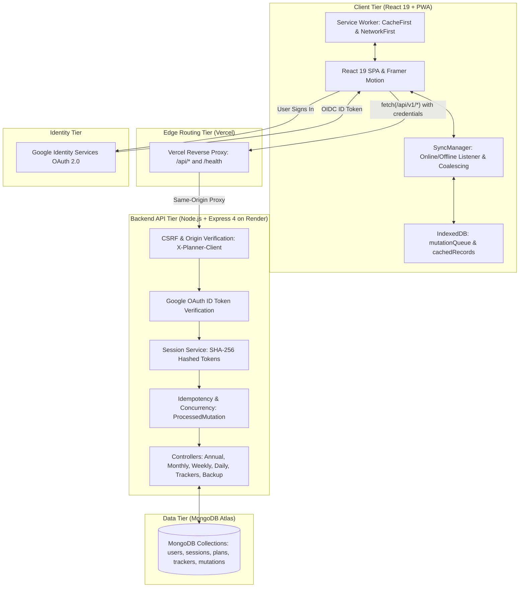

# Guided Annual Planner — Mindful Growth Edition

[](LICENSE)
[](https://www.typescriptlang.org/)
[](https://react.dev/)
[](https://vitejs.dev/)
[](https://nodejs.org/)
[](https://expressjs.com/)
[](https://www.mongodb.com/)
[](https://github.com/petersisay/guided-annual-planner)
[](https://guided-annual-planner.vercel.app/)
[](https://guided-annual-planner.onrender.com/health)

A warm, paper-inspired digital sanctuary and Progressive Web App (PWA) designed to turn long-term annual intentions into manageable, compounding daily craft.

> *"Doing small things before taking major steps compounds over time to create a huge impact."*

**Live Deployments:**
- **Web Application**: [https://guided-annual-planner.vercel.app/](https://guided-annual-planner.vercel.app/)
- **Backend API Health Check**: [https://guided-annual-planner.onrender.com/health](https://guided-annual-planner.onrender.com/health)
- **GitHub Repository**: [https://github.com/petersisay/guided-annual-planner](https://github.com/petersisay/guided-annual-planner)

---

## Application Screenshots

The user interface reproduces the warm tactile aesthetic of physical spiral-bound notebooks created in Ethiopia, combining serif typography, dot-grid paper textures, and clear visual progress trackers.

| **Annual Horizon & Calendar Grid** | **Monthly Intentions & Bookshelf** |
| :---: | :---: |
| <br><sub><strong>Annual Horizon & Calendar Grid</strong><br>12-month calendar horizon with automatic leap-year handling, annual intention theme, and milestone reflections.</sub> | <br><sub><strong>Monthly Intentions & Bookshelf</strong><br>Top 6 Must-Do priorities, 5 new habits, To-Buy inventory card, 5-book interactive bookshelf, and self-change reflection.</sub> |
| **Weekly 7-Day Planner Spread** | **Daily Focus & Evening Reflection** |
| <br><sub><strong>Weekly 7-Day Planner</strong><br>Full 7-day ISO calendar spread structured around the Rule of 3 with configurable week-start days (Monday/Sunday).</sub> | <br><sub><strong>Daily Focus & Evening Journal</strong><br>Top 3 non-negotiable daily priorities, secondary task checklist, hourly schedule blocks, and 4-part guided gratitude journal.</sub> |
| **Habit & Mood Consistency Maps** | **Creator Story & Backup Hub** |
| <br><sub><strong>Habit & Mood Consistency Maps</strong><br>Full-year GitHub-style consistency heatmaps calculating routine completion and emotional trends across all 365/366 days.</sub> | <br><sub><strong>Creator Story & Backup Hub</strong><br>The founding philosophy behind the planner, user display preferences, and zero lock-in JSON export/import data hub.</sub> |

> *All screenshot assets are tracked in the repository under [reference_images/](reference_images/).*

---

## Table of Contents

- [Application Screenshots](#application-screenshots)
- [Documentation Hub](#documentation-hub)
- [Overview & Problem Solved](#overview--problem-solved)
- [Key Features](#key-features)
- [Technology Stack](#technology-stack)
- [System Architecture](#system-architecture)
- [Application Workflow & Authentication](#application-workflow--authentication)
- [Project Directory Structure](#project-directory-structure)
- [Prerequisites](#prerequisites)
- [Local Installation & Setup](#local-installation--setup)
- [Environment Variables](#environment-variables)
- [Development Commands](#development-commands)
- [Automated Testing & Production Build](#automated-testing--production-build)
- [Security & Privacy Practices](#security--privacy-practices)
- [Offline Architecture & Synchronization](#offline-architecture--synchronization)
- [Data Backup & Disaster Recovery](#data-backup--disaster-recovery)
- [Production Deployment Guide](#production-deployment-guide)
- [Troubleshooting](#troubleshooting)
- [Contributing](#contributing)
- [License & Author](#license--author)

---

## Documentation Hub

Comprehensive, in-depth architectural and developer documentation is maintained in the [`docs/`](docs/) directory:

| Document | Description |
| :--- | :--- |
| [**Architecture & System Design**](docs/ARCHITECTURE.md) | Monorepo structure, layered architecture, component tree, and edge reverse-proxy. |
| [**REST API Reference**](docs/API_REFERENCE.md) | Endpoint specifications (`/auth`, `/planner`, `/trackers`, `/backup`), headers, and payloads. |
| [**Data Models & Schemas**](docs/DATA_MODELS.md) | MongoDB collections, Mongoose models, compound unique indexes, and JSON backup schema. |
| [**Offline-First & Synchronization**](docs/OFFLINE_AND_SYNC.md) | IndexedDB stores, mutation coalescing, optimistic concurrency control, and conflict handling. |
| [**Security & Privacy Posture**](docs/SECURITY.md) | Database-backed SHA-256 sessions, CSRF headers, Google OIDC signature verification, and tenant isolation. |
| [**Contributing Guidelines**](docs/CONTRIBUTING.md) | Development workflow, branching strategy, Conventional Commits format, and PR checklist. |
| [**Production Deployment Runbook**](DEPLOYMENT.md) | Full cloud operations guide for Vercel, Render, and MongoDB Atlas. |

---

## Overview & Problem Solved

Traditional productivity applications often exacerbate cognitive fatigue through aggressive notifications, infinite backlogs, and sterile corporate interfaces. Conversely, physical guided journals provide grounding tactile clarity but lack cross-device accessibility, searchability, and offline backup resilience.

**Guided Annual Planner** bridges this divide. Inspired by tactile guided journals created in Ethiopia, the platform provides a calm, warm-paper digital environment rooted in the philosophy that *"doing small things before taking major steps compounds over time to create a huge impact."*

The application structures personal growth into a cascading hierarchy:
1. **Annual Horizon**: Define a unifying theme word, core milestone intentions, and year-end retrospectives.
2. **Monthly Intentions**: Establish non-negotiable must-dos, habits, reading goals, and reflections.
3. **Weekly Rhythms**: Plan across a 7-day ISO calendar spread using the Rule of 3.
4. **Daily Focus**: Limit essential priorities to three items, schedule hourly blocks, and close the evening with a 4-part structured journal.
5. **Continuous Tracking**: Monitor habits and emotional trends with annual GitHub-style consistency heatmaps.
6. **Bilingual Accessibility**: Full bilingual support in English and Amharic (አማርኛ), honoring authentic Ethiopic typography and date contexts.

---

## Key Features

### 1. Annual Horizon Spread (`/annual`)
- **Yearly Theme Word**: Anchor the year to a single guiding principle (e.g., *Resilience*, *Focus*, *Compounding*).
- **Core Intentions**: Establish 3–5 milestone goals across personal, professional, and wellness domains.
- **Year-in-Review Retrospective**: Structured prompts for celebrations, obstacles overcome, and lessons learned.
- **Dynamic 12-Month Grid**: Rapid navigation across all months with automatic leap-year calculation.

### 2. Monthly Intentions Spread (`/monthly/:year/:month`)
- **Dashboard Mode**:
  - **Top 6 Must-Do's**: Monthly non-negotiables with interactive status checkmarks.
  - **5 New Habits**: High-leverage behavioral routines to build.
  - **To-Buy Inventory**: Structured tracker for books, tools, and personal growth resources.
  - **Interactive Bookshelf**: 5 book slots featuring customizable spine titles, authors, progress toggles, and warm color palettes.
  - **Self-Change Reflection**: Guided open-ruled space for mental models to adopt or unlearn.
- **Calendar Grid Mode**: 35-day grid spread with click-to-edit notes for any day.
- **Trackers Mode**: Monthly breakdown of annual habit and mood consistency.

### 3. Weekly 7-Day Planner (`/weekly/:year/:week`)
- **ISO 8601 Calendar Navigation**: Traverse weeks 1 through 52/53 with accurate weekday offsets.
- **Rule of 3 Priorities**: Focus each week on three high-leverage outcomes.
- **7-Day Spread**: Dedicated daily task slots respecting user week-start preferences (Monday or Sunday).
- **Weekly Retrospective**: End-of-week reflection on what worked and what requires adjustment.

### 4. Daily Focus & Evening Journal (`/daily`)
- **The Rule of 3 (Primary Priorities)**: Guard against overcommitment by capping top daily outcomes at three.
- **Secondary Tasks**: Flexible checklist with inline addition and removal.
- **Hourly Schedule Blocks**: Configurable time intervals (e.g., `07:00`, `09:30`, `14:00`) with completion markers.
- **Structured 4-Part Evening Journal**:
  1. *Gratitude*: 3 distinct ruled prompts for grounded appreciation.
  2. *Daily Wins*: Celebrating small, compounding progress.
  3. *Challenges & Lessons Learned*: Reframing daily obstacles into actionable feedback.
  4. *Free Reflection*: Open lined space for stream-of-consciousness journaling.

### 5. Habit & Mood Consistency Trackers
- **Annual Habit Heatmap**: Full-year visual grid measuring routine execution with multi-level color scaling.
- **Emotional Trends Map**: Daily wellbeing logging across 5 calibrated emotional states (*Radiant*, *Calm*, *Neutral*, *Low*, *Difficult*).

### 6. Bilingual Support (English & Amharic)
- Instant client-side language switching between English and Amharic (`አማርኛ`).
- Ethiopic font integration (`Noto Sans Ethiopic` and `Noto Serif Ethiopic`) with localized calendar navigation, months, weekdays, and UI labels.

### 7. Offline Resilience & Sync Management
- PWA capability with service worker asset caching.
- Optimistic UI updates with IndexedDB background queueing (`idb`).
- Automatic mutation coalescing and network replay upon reconnection.
- Interactive conflict resolution dialog (`HTTP 409`) preserving offline edits or pulling cloud records.

### 8. Data Sovereignty & Portability
- Complete JSON backup export with zero vendor lock-in.
- Pre-restore preview and Zod schema validation before applying records.
- Strict tenant isolation ensuring users can only read and restore their own data.

---

## Technology Stack

### Frontend Client (`@planner/client`)
- **Core Framework**: React 19 SPA with TypeScript 5
- **Build Tooling**: Vite 6 with production chunking and gzip compression
- **Styling**: Tailwind CSS with paper-texture utilities, dot-grids, and ruled-notebook backgrounds
- **Animation**: Framer Motion with reduced-motion accessibility compliance (`prefers-reduced-motion`)
- **Icons**: Lucide React
- **Local Persistence**: IndexedDB via `idb`
- **Routing**: React Router v7 with protected route boundaries
- **Internationalization**: Custom lightweight context supporting English and Amharic

### Shared Contracts (`@planner/shared`)
- **Validation**: Zod 3 schemas shared identically between client and server
- **Date Math**: ISO 8601 calendar calculations, leap-year logic, and timezone-agnostic day helpers
- **TypeScript Types**: Canonical domain models for Plans, Users, Trackers, and Backups

### Backend API Service (`@planner/server`)
- **Runtime**: Node.js (v18+) with Express 4
- **Language**: TypeScript 5 compiled to ES2022
- **Data Persistence**: MongoDB Atlas with Mongoose 8 ORM
- **Authentication**: Google Identity Services OAuth 2.0 with server-side token verification via `google-auth-library`
- **Session Management**: Database-backed sessions using SHA-256 token hashing and `HttpOnly`, `SameSite=Lax`, `Secure` cookies (stateless JWTs are intentionally avoided to ensure immediate revocation capability)
- **Security & Headers**: Helmet, CORS origin restriction, and custom CSRF protection (`X-Planner-Client` header verification)
- **Rate Limiting**: `express-rate-limit` on sensitive authentication endpoints (15 req / 15 min)

### Infrastructure & Deployment
- **Frontend Hosting**: Vercel Edge Network with automatic reverse proxy rewrites for `/api/*`
- **Backend Hosting**: Render Web Service (Node.js runtime with health check probe)
- **Database**: MongoDB Atlas Replica Set (M0) with TLS/SSL encryption

---

## System Architecture

The monorepo enforces shared schemas across workspaces to eliminate API contract drift:



---

## Application Workflow & Authentication

```
[Guest Visitor]
       │
       ▼
[Landing Page / Login] ──▶ Authenticate with Google One Tap / Button
       │
       ├── 1. Client receives Google ID Token
       ├── 2. POST /api/v1/auth/google { credential }
       ├── 3. Server verifies token with google-auth-library
       ├── 4. Upsert User in MongoDB
       ├── 5. Generate cryptographically random session secret
       ├── 6. Store SHA-256 hash in sessions collection
       └── 7. Set HttpOnly, SameSite=Lax, Secure session cookie
       │
       ▼
[Authenticated Session]
       │
       ├── Top Bar: Annual Horizon, Month Switcher, Save Status Badge, Language Selector
       ├── Workspace: Annual ──▶ Monthly ──▶ Weekly ──▶ Daily Focus
       ├── Trackers: Habit & Mood Consistency Maps
       └── Settings: Week-start preference, JSON Backup Export & Restore
```

---

## Project Directory Structure

```
guided-annual-planner/
├── .env.example                  # Safe template environment variables for development
├── package.json                  # Root monorepo workspaces (shared, server, client)
├── tsconfig.json                 # Base TypeScript compiler configuration
├── vercel.json                   # Vercel deployment rewrites and proxy definitions
├── render.yaml                   # Render Blueprint definition for the backend service
├── DEPLOYMENT.md                 # Production deployment runbook and operations guide
├── LICENSE                       # ISC open-source license
├── reference_images/             # UI reference screenshots of core planner views
│
├── shared/                       # Workspace: @planner/shared
│   ├── src/
│   │   ├── types/                # Canonical User, Planner, Habit, Mood, Sync, and Backup types
│   │   ├── schemas/              # Zod validation schemas (auth, backup, user, planner)
│   │   ├── utils/                # ISO week calculations, leap year & calendar date math
│   │   └── index.ts              # Canonical barrel exports
│   └── package.json
│
├── server/                       # Workspace: @planner/server
│   ├── src/
│   │   ├── config/               # env.ts (Zod-validated environment), db.ts (Mongoose connection)
│   │   ├── models/               # User, Session, AnnualPlan, MonthlyPlan, WeeklyPlan, DailyPlan, ProcessedMutation
│   │   ├── services/             # googleAuth.service.ts, session.service.ts
│   │   ├── middleware/           # auth.middleware.ts, csrf.middleware.ts, error.middleware.ts
│   │   ├── controllers/          # auth, annual, monthly, weekly, daily, tracker, user, backup
│   │   ├── routes/               # Express routers for /api/v1/*
│   │   ├── app.ts                # Express application factory with Helmet, CORS, and CSRF
│   │   └── index.ts              # Server bootstrap and cluster entry point
│   └── package.json
│
└── client/                       # Workspace: @planner/client
    ├── src/
    │   ├── components/
    │   │   ├── annual/           # YearCalendarGrid, MoodTrackerHeatmap, HabitTrackerHeatmap
    │   │   ├── monthly/          # MonthlyDashboard, MonthlyCalendarGrid, BookModal
    │   │   ├── weekly/           # WeeklyTaskList, WeeklyNotes
    │   │   ├── daily/            # DailyPrioritiesAndTasks, DailyScheduleBlocks, DailyJournal
    │   │   ├── journal/          # CircleCheckbox, RuledInput, Bookshelf, SpiralBinding
    │   │   ├── layout/           # PlannerLayout (sidebar, navigation, indicators)
    │   │   └── common/           # GlobalConflictModal, LanguageSelector, SaveStatusBadge
    │   ├── context/              # AuthContext.tsx, LanguageContext.tsx
    │   ├── hooks/                # usePlanAutosave.ts (optimistic updates, debounced saving)
    │   ├── services/             # syncManager.ts (IndexedDB replay, online/offline lifecycle)
    │   ├── utils/                # offlineDb.ts, localStorageBackup.ts, pwa.ts
    │   ├── pages/                # HomePage, LoginPage, OnboardingPage, Annual, Monthly, Weekly, Daily, Settings
    │   ├── styles/               # index.css (paper textures, dot-grid, reduced motion)
    │   ├── App.tsx               # Lazy-loaded routes, ProtectedRoute boundaries
    │   └── main.tsx              # React 19 application mount
    └── package.json
```

---

## Prerequisites

- **Node.js**: `v18.0.0` or higher (verified on Node v20, v22, and v24)
- **npm**: `v9.0.0` or higher (supports npm workspaces)
- **MongoDB**: Local MongoDB instance (`mongodb://127.0.0.1:27017/guided_planner`) or MongoDB Atlas cluster URI
- **Google Cloud Console**: OAuth 2.0 Web Client ID (for Google Identity Services)

---

## Local Installation & Setup

### 1. Clone the Repository
```bash
git clone https://github.com/petersisay/guided-annual-planner.git
cd guided-annual-planner
```

### 2. Install Dependencies
```bash
npm install
```

### 3. Build the Shared Workspace
The shared workspace must be compiled prior to starting the development servers:
```bash
npm run build:shared
```

### 4. Configure Environment Variables
Copy `.env.example` into both `server/.env` and `client/.env`:

```bash
# Copy template
cp .env.example server/.env
cp .env.example client/.env
```

Edit each file with your development settings (see [Environment Variables](#environment-variables)).

### 5. Launch Development Servers
Run the backend and frontend concurrently in two separate terminal sessions:

```bash
# Terminal 1: Backend API (runs on http://localhost:5000)
npm run dev:server

# Terminal 2: Frontend Client (runs on http://localhost:5173)
npm run dev:client
```

Open [http://localhost:5173](http://localhost:5173) in your browser.

---

## Environment Variables

Safe placeholders are documented below. **Never commit production credentials or private keys to source control.**

### Backend (`server/.env`)

| Variable | Required | Default / Example | Purpose |
| :--- | :---: | :--- | :--- |
| `NODE_ENV` | Yes | `development` | Set to `production` in live deployments. Enforces `COOKIE_SECURE=true` and disables dev login routes. |
| `PORT` | No | `5000` | Local port for Express API server. |
| `CLIENT_ORIGIN` | Yes | `http://localhost:5173` | Allowed frontend HTTPS origin for CORS and CSRF verification. |
| `MONGODB_URI` | Yes | `mongodb://127.0.0.1:27017/guided_planner` | MongoDB Atlas or local connection string with TLS/SSL enabled in production. |
| `SESSION_SECRET` | Yes | *(minimum 32 characters)* | Cryptographic key for HMAC-SHA256 session tokens. Server rejects boot if default key is used in production. |
| `COOKIE_NAME` | No | `planner_session` | Name of the session cookie. |
| `COOKIE_SECURE` | Yes | `false` | Must be `true` in production to enforce HTTPS-only cookie transmission. |
| `GOOGLE_CLIENT_ID` | Yes | `your_client_id.apps.googleusercontent.com` | Google Cloud OAuth 2.0 Client ID for server-side token signature verification. |

### Frontend (`client/.env`)

| Variable | Required | Default / Example | Purpose |
| :--- | :---: | :--- | :--- |
| `VITE_API_BASE_URL` | No | `http://localhost:5000/api/v1` | Base API URL. In production with Vercel rewrites, defaults to `/api/v1`. |
| `VITE_GOOGLE_CLIENT_ID` | Yes | `your_client_id.apps.googleusercontent.com` | Google OAuth Client ID rendered in the Google Sign-In button. Must match the server value. |

---

## Development Commands

All commands can be executed from the repository root:

```bash
# Run all workspace test suites
npm test

# Run tests by workspace
npm run test:server       # Run server unit & integration tests
npm run test:client       # Run client React testing library tests
npm run test --workspace=shared # Run shared schema and utility tests

# Run development watchers
npm run dev:server        # Start server with tsx hot-reloading
npm run dev:client        # Start Vite dev server with HMR

# Production builds
npm run build             # Build shared, server, and client in topological order
npm run build:shared      # Compile shared TypeScript definitions
npm run build:server      # Compile server TypeScript bundle
npm run build:client      # Compile client Vite PWA production bundle
```

---

## Automated Testing & Production Build

The codebase maintains automated test coverage across the full MERN monorepo stack:

- **Total Automated Tests**: **202 passed** across 33 test files (0 failing, 0 flaky)
  - `@planner/shared`: **20 passed** (Zod validation schemas, ISO week date math, leap year checks)
  - `@planner/server`: **90 passed** (Controllers, session security, CSRF protection, concurrency handling, backup transactions)
  - `@planner/client`: **92 passed** (Page components, offline IndexedDB sync, PWA prompts, accessibility, reduced motion)

### Running Tests
```bash
# Execute entire test suite
npm test
```

### Production Build Verification
```bash
npm run build
```
Build verification validates:
- TypeScript type checking with zero compiler errors across all three workspaces.
- Production bundle generation with chunk splitting and gzip compression.

---

## Security & Privacy Practices

1. **Server-Side Token Verification**:
   The frontend never handles Google Client Secrets. Google ID tokens received by the client are sent to `/api/v1/auth/google` where the backend verifies the token signature directly against Google's public keys via `google-auth-library`.
2. **Database-Backed Sessions with SHA-256 Hashing**:
   Rather than using stateless JWTs that cannot be revoked on demand, session secrets are stored in MongoDB as SHA-256 hashes. Calling logout immediately destroys the database session.
3. **HttpOnly, SameSite Cookies**:
   Session tokens reside strictly in `HttpOnly`, `SameSite=Lax`, and `Secure` (production) cookies. Client-side scripts cannot access session tokens, mitigating XSS token theft.
4. **Custom CSRF Protection**:
   State-changing requests (`POST`, `PUT`, `DELETE`) require the custom header `X-Planner-Client: WebApp` and validate the `Origin` header against `CLIENT_ORIGIN`. Modern browsers forbid cross-origin requests from setting custom headers without explicit CORS approval.
5. **Strict Rate Limiting**:
   Authentication endpoints enforce IP-based rate limiting via `express-rate-limit` (15 requests per 15 minutes) to protect against credential stuffing and brute-force attacks.
6. **Strict Tenant Isolation**:
   Every database query filters explicitly by `userId` extracted from the validated server session. Users cannot access, modify, or restore records belonging to other accounts.

---

## Offline Architecture & Synchronization

Guided Annual Planner employs an offline-first architecture via IndexedDB and Service Workers:

```
[User Edits Plan Spread]
          │
          ▼
[Optimistic UI Update] ──▶ Update React state instantly
          │
          ├── Online ──▶ Send PUT /api/v1/planner/* with expectedUpdatedAt
          │               │
          │               ├── 200 OK: Persist to IndexedDB cachedRecords
          │               └── 409 Conflict: Trigger interactive conflict modal
          │
          └── Offline ──▶ Enqueue into IndexedDB mutationQueue (Coalesced per Entity)
                           │
                           ▼
              [Network Restored ('online')]
                           │
                           ▼
              [SyncManager Replays Queue] ──▶ Replay pending mutations sequentially
```

- **Mutation Coalescing**: Multiple edits to the same spread while offline are merged locally in IndexedDB to avoid enqueuing redundant HTTP calls.
- **Optimistic Concurrency Control**: Requests carry `expectedUpdatedAt` timestamps. If another client modified the record in the interim, the server responds with `HTTP 409 CONCURRENT_MODIFICATION_CONFLICT`.
- **Conflict Resolution Options**:
  - *Keep Local Changes*: Unconditionally overwrites cloud with local edits.
  - *Keep Cloud Version*: Discards local offline edits and updates state with cloud data.
  - *Download Rescue Backup*: Exports local queued mutations to an emergency `.json` file.

---

## Data Backup & Disaster Recovery

- **Exporting a Backup**:
  From **Settings & Backup** (`/settings`), click **"Download Complete Backup"**. The server aggregates all user plans, habits, mood logs, and preferences into a single formatted JSON archive (`guided-annual-planner-backup-[DATE].json`).
- **Restoring a Backup**:
  Upload your JSON backup file. The client previews the record counts (annual plans, monthly plans, weekly plans, daily plans, habits, mood logs). Upon confirmation, the payload is validated against shared Zod schemas before persisting.
- **Emergency Unsynced Export**:
  If network issues prevent synchronization, click **"Download Rescue Backup"** in the sidebar. This extracts uncommitted mutations directly from IndexedDB to your local device.

---

## Production Deployment Guide

The production system runs on a decoupled cloud architecture:

### 1. Frontend (Vercel)
- **Deployment URL**: [https://guided-annual-planner.vercel.app/](https://guided-annual-planner.vercel.app/)
- **Build Command**: `npm run build:shared && npm run build:client`
- **Output Directory**: `client/dist`
- **Reverse Proxy**: [vercel.json](vercel.json) rewrites `/api/:path*` and `/health` to the Render backend, allowing same-origin cookie transport without third-party cookie restrictions.

### 2. Backend (Render)
- **API URL**: [https://guided-annual-planner.onrender.com/](https://guided-annual-planner.onrender.com/)
- **Build Command**: `npm install --include=dev && npm run build:shared && npm run build:server`
- **Start Command**: `npm run start --workspace=server`
- **Environment**: `NODE_ENV=production`, `PORT=5000`, `CLIENT_ORIGIN=https://guided-annual-planner.vercel.app`, `COOKIE_SECURE=true`.

### 3. Database (MongoDB Atlas)
- **Topology**: M0 replica set cluster with automatic failover, TLS 1.3 encryption, and IP access list restrictions.

*For complete operational procedures and rollback strategies, see [DEPLOYMENT.md](DEPLOYMENT.md).*

---

## Troubleshooting

### 1. Google Sign-In Fails with `Origin Mismatch` (Error 400)
- **Cause**: The current domain or port is not listed in Authorized JavaScript Origins in Google Cloud Console.
- **Resolution**: In [Google Cloud Console](https://console.cloud.google.com/) &rarr; APIs & Services &rarr; Credentials &rarr; OAuth 2.0 Client ID, add:
  - `http://localhost:5173` (for local development)
  - `https://guided-annual-planner.vercel.app` (for production)

### 2. `CSRF_FORBIDDEN: Untrusted request origin`
- **Cause**: `CLIENT_ORIGIN` in `server/.env` does not match the frontend origin sending requests.
- **Resolution**: Confirm `CLIENT_ORIGIN` matches your frontend URL exactly (e.g., `http://localhost:5173` locally or `https://guided-annual-planner.vercel.app` in production) without a trailing slash.

### 3. Server Startup Fails with `SESSION_SECRET cannot use default key`
- **Cause**: `NODE_ENV` is set to `production`, but `SESSION_SECRET` is set to the default placeholder.
- **Resolution**: Generate a secure 32+ character random secret (e.g. `openssl rand -hex 32`) and update `SESSION_SECRET`.

### 4. Client Cannot Connect to Backend Locally
- **Cause**: Backend server is inactive or running on a different port.
- **Resolution**: Verify backend health at `http://localhost:5000/health`. Confirm `VITE_API_BASE_URL=http://localhost:5000/api/v1` in `client/.env`.

---

## Contributing

Contributions and feedback are welcome!

1. Fork the repository on GitHub.
2. Create a feature branch:
   ```bash
   git checkout -b feature/your-feature-name
   ```
3. Commit your changes using [Conventional Commits](https://www.conventionalcommits.org/):
   ```bash
   git commit -m "feat(daily): add keyboard shortcut for priority reordering"
   ```
4. Run the full test suite:
   ```bash
   npm test
   ```
5. Push to your branch and open a Pull Request.

---

## License & Author

- **Author**: Peter Sisay ([@petersisay](https://github.com/petersisay))
- **Live Application**: [https://guided-annual-planner.vercel.app/](https://guided-annual-planner.vercel.app/)
- **License**: Licensed under the [ISC License](LICENSE). Copyright &copy; 2026 Peter Sisay.
