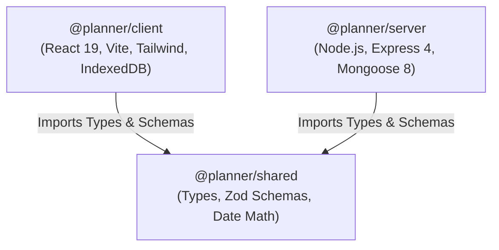
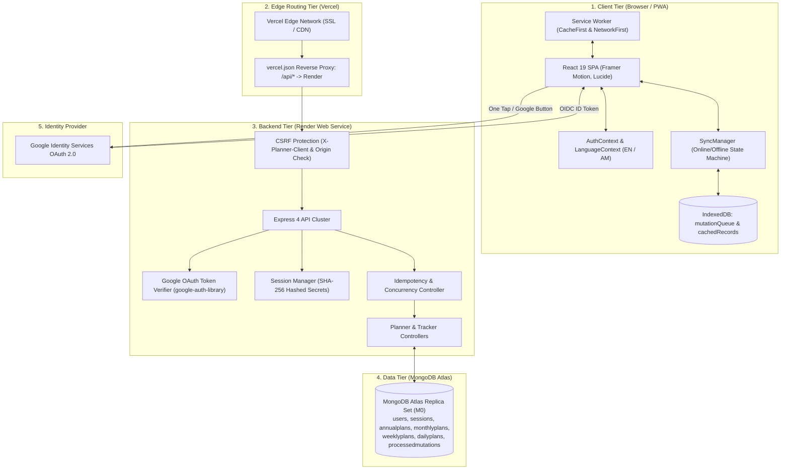

# Guided Annual Planner — Architecture & System Design

**Project**: Guided Annual Planner (Mindful Growth Edition)  
**Author**: Peter Sisay  
**Repository**: [github.com/petersisay/guided-annual-planner](https://github.com/petersisay/guided-annual-planner)  
**Live Application**: [guided-annual-planner.vercel.app](https://guided-annual-planner.vercel.app/)  
**Live API Health**: [guided-annual-planner.onrender.com/health](https://guided-annual-planner.onrender.com/health)

---

## 1. Architectural Philosophy

Guided Annual Planner is engineered as a calm, paper-inspired digital sanctuary. The architecture prioritizes:
1. **Zero-Latency Interactions**: Every user action (checking off a task, recording a mood, typing an intention) updates the UI optimistically within milliseconds.
2. **Offline-First Data Sovereignty**: All changes are enqueued in local browser storage (IndexedDB) and synchronized automatically when network connectivity is established.
3. **Strict Type Safety & Contract Sharing**: A shared monorepo package eliminates drift between client expectations and server validations.
4. **Resilient Session Security**: Database-backed sessions using SHA-256 token hashing and `HttpOnly`, `SameSite=Lax`, `Secure` cookies provide immediate revocability without the vulnerabilities of stateless JWTs.

---

## 2. Monorepo Structure & Workspace Dependencies

The project uses npm workspaces to manage three packages in a single repository:



### Workspace Responsibilities

| Workspace | Directory | Role & Contents |
| :--- | :--- | :--- |
| `@planner/shared` | `shared/` | Shared TypeScript domain types, Zod validation schemas (`auth`, `planner`, `backup`, `user`), and timezone-agnostic date calculation utilities (ISO week numbers, leap years, month boundaries). |
| `@planner/server` | `server/` | Express 4 REST API, Mongoose models, Google OAuth 2.0 token verification, session lifecycle management, CSRF middleware, rate limiting, and backup transactions. |
| `@planner/client` | `client/` | React 19 Single Page Application (SPA), Vite 6 build pipeline, Tailwind CSS design tokens, Framer Motion animations, Service Worker PWA caching, and IndexedDB sync manager. |

---

## 3. High-Level System Architecture



---

## 4. Frontend Component Hierarchy

The frontend architecture organizes components into clear functional layers:

```
App.tsx (Router, LanguageProvider, AuthProvider)
├── ProtectedRoute
│   └── PlannerLayout (Paper-notebook spiral binding, responsive sidebar)
│       ├── Header Actions (SaveStatusBadge, LanguageSelector, HowItWorksModal)
│       └── Active Route View
│           ├── AnnualViewPage
│           │   ├── YearCalendarGrid (12-month calendar cards, leap-year indicator)
│           │   ├── MoodTrackerHeatmap (Daily emotional mapping)
│           │   ├── HabitTrackerHeatmap (365-day habit streaks)
│           │   ├── AnnualIntentionCard (Yearly theme & core milestones)
│           │   └── AnnualReviewSection (Retrospective prompts)
│           ├── MonthlyViewPage
│           │   ├── MonthlyDashboard (Top 6 Must-Dos, 5 Habits, To-Buy list)
│           │   ├── Bookshelf (5-book interactive spine shelf with color swatches)
│           │   └── MonthlyCalendarGrid (35-day month spread with click-to-edit notes)
│           ├── WeeklyViewPage
│           │   ├── WeeklySpread (7-day ISO calendar slots, Rule of 3 priorities)
│           │   └── WeeklyNotes (Weekly retrospective and carryover tasks)
│           ├── DailyViewPage
│           │   ├── DailyPrioritiesAndTasks (The Rule of 3 + secondary checklist)
│           │   ├── DailyScheduleBlocks (Hourly timeline intervals)
│           │   └── DailyJournal (4-part evening reflection: gratitude, wins, lessons)
│           └── SettingsPage
│               ├── PreferencesForm (Week-start: Monday vs. Sunday)
│               └── BackupManager (JSON export, schema validation preview, restore)
└── Public Routes
    ├── HomePage (Public landing page, hero, interactive previews, creator story)
    └── LoginPage (Journal-themed authentication card, Google Sign-In)
```

---

## 5. State Management & Data Flow

### 1. Application-Level Contexts
- **`AuthContext`**: Manages user authentication state, profile data, loading flags, login/logout operations, and session refresh probes (`/api/v1/auth/me`).
- **`LanguageContext`**: Provides bilingual translations dictionary (`t`) and switching between English (`en`) and Amharic (`am`). Sets `document.documentElement.lang` and persists user preference in `localStorage`.

### 2. Autosave Hook (`usePlanAutosave`)
- Implements optimistic UI updates with debounced background synchronization (1000ms delay).
- Tracks modification timestamps (`updatedAt`) to support optimistic concurrency control.
- Exposes real-time save states (`saved`, `saving`, `offline`, `error`, `conflict`) consumed by `SaveStatusBadge`.

### 3. Sync Manager (`syncManager`)
- Singleton state machine listening to `window.addEventListener('online')` and `window.addEventListener('offline')`.
- Manages an IndexedDB store named `mutationQueue` with auto-incrementing sequence keys.
- **Coalescing Engine**: If a user modifies the same daily plan three times while offline, the queue merges the changes into a single consolidated payload rather than firing three separate network mutations upon reconnect.

---

## 6. Edge Reverse-Proxy & CORS Architecture

In production, frontend assets are served by Vercel (`https://guided-annual-planner.vercel.app`), while the API runs on Render (`https://guided-annual-planner.onrender.com`).

To avoid third-party cookie restrictions enforced by modern web browsers (Safari ITP, Chrome Privacy Sandbox), Vercel reverse-proxies API requests through `vercel.json`:

```json
{
  "rewrites": [
    {
      "source": "/api/:path*",
      "destination": "https://guided-annual-planner.onrender.com/api/:path*"
    },
    {
      "source": "/health",
      "destination": "https://guided-annual-planner.onrender.com/health"
    }
  ]
}
```

### Benefits of this Pattern:
- **First-Party Cookie Transport**: Requests to `/api/*` travel as same-origin requests from the browser's perspective.
- **Zero Third-Party Cookie Blocking**: Cookies marked `SameSite=Lax` and `Secure` are delivered seamlessly.
- **Single Public Surface**: Clients only communicate with `guided-annual-planner.vercel.app`.

---

## 7. Performance & Bundle Optimization

1. **Lazy Loading**: Route-level code splitting using `React.lazy()` and `Suspense` ensures visitors download only the JavaScript needed for the current screen.
2. **Gzip Chunk Splitting**: Production Vite bundles chunk external libraries (`vendor-react`, `calendar-math`, `icons`) separately to maximize browser cache hits.
3. **Sub-Pixel Font & Texture Rendering**: Paper textures use CSS gradients (`repeating-linear-gradient` and `radial-gradient`) rather than heavy raster textures, keeping the client bundle under 500 kB gzip.
4. **Reduced-Motion Compliance**: Global cursor particles and click ripple animations query `window.matchMedia('(prefers-reduced-motion: reduce)')` to minimize GPU load and respect accessibility preferences.
