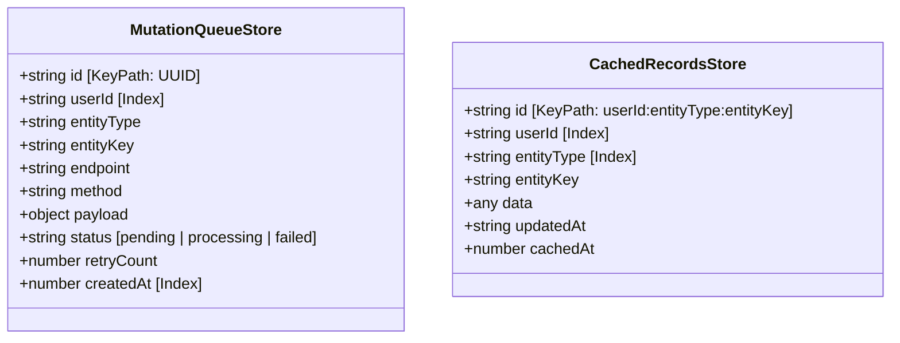
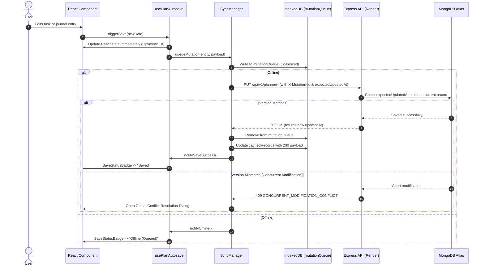

# Guided Annual Planner — Offline-First & Synchronization Guide

**IndexedDB Database**: `guided_planner_offline_db` (Version 1)  
**Service Worker**: Workbox-powered PWA with `CacheFirst` and `NetworkFirst` tiers  
**Client Orchestration**: `SyncManager` & `usePlanAutosave`

---

## 1. Offline Philosophy & Resilience Strategy

The Guided Annual Planner is engineered with an **offline-first** design. Users can plan their days, update priorities, track habits, and write evening reflections on trains, airplanes, or in areas with intermittent connectivity without interruption or risk of data loss.

### Three Pillars of the Sync Architecture:
1. **Instant UI Feedback (Zero Blocking)**: Updates apply to React component state synchronously within a few milliseconds.
2. **Local Durability (IndexedDB)**: Every mutation is persisted locally in an IndexedDB queue before any network request completes.
3. **Optimistic Concurrency Control (OCC)**: Requests include `expectedUpdatedAt` timestamps to prevent silent cloud overwrites when two devices edit the same day or spread.

---

## 2. IndexedDB Schema Architecture

The browser stores offline data inside `guided_planner_offline_db` across two object stores:



### Store 1: `mutationQueue`
Tracks uncommitted changes made while offline or during intermittent network connectivity:
- **`id`** (`string`): Unique mutation UUID generated client-side via `crypto.randomUUID()`.
- **`userId`** (`string`): Scopes mutations to prevent cross-account sync leakage if multiple users share a machine.
- **`entityType`** (`string`): `'annual' | 'monthly' | 'weekly' | 'daily' | 'mood' | 'habit' | 'preference'`.
- **`entityKey`** (`string`): Target key (e.g., `'2026'`, `'2026-10'`, `'2026-43'`, `'2026-10-26'`).
- **`status`** (`string`): `'pending' | 'processing' | 'failed'`.
- **`retryCount`** (`number`): Incremented upon network errors with exponential backoff.

### Store 2: `cachedRecords`
Acts as a local mirror of cloud data:
- Composite key: `${userId}:${entityType}:${entityKey}`
- Cached alongside the server's `updatedAt` ISO timestamp.
- When an API request fails due to network disconnection, the UI falls back to `cachedRecords`.

---

## 3. Mutation Coalescing Engine

When a user works offline for an extended duration, they might check and uncheck tasks, reword daily intentions, or edit journal entries dozens of times. Sending 50 sequential HTTP requests upon reconnecting is slow and error-prone.

The **Coalescing Engine** in `syncManager.ts` prevents queue explosion:

```
[User updates Daily Task 1] ──▶ Enqueued as Mutation #1
          │
[User updates Daily Task 2] ──▶ Coalescing checks if pending mutation exists
          │                     for `userId:daily:2026-10-26`
          │                     
          ▼
[Merge Payload] ──────────────▶ Updates Mutation #1 in-place in IndexedDB
                                (Total queue count remains 1)
```

### Coalescing Rules:
- If a pending mutation for the same entity already exists in `mutationQueue`, its payload is merged with the incoming delta.
- The `updatedAt` and timestamp headers are refreshed.
- Only the single consolidated state is transmitted once connectivity returns.

---

## 4. End-to-End Synchronization Flow



---

## 5. Conflict Resolution (`HTTP 409`)

When a user modifies a plan on a laptop and subsequently edits the same plan on a tablet without syncing, the server detects a timestamp divergence:

```json
{
  "success": false,
  "error": {
    "code": "CONCURRENT_MODIFICATION_CONFLICT",
    "message": "This plan was modified on another device.",
    "currentServerUpdatedAt": "2026-10-26T15:00:00.000Z",
    "expectedUpdatedAt": "2026-10-26T12:00:00.000Z"
  }
}
```

The frontend catches `409 Conflict` and opens the **Conflict Resolution Modal** (`ConflictResolutionModal.tsx`), giving the user three clear options:

1. **Keep My Local Edits**:
   - Sends the local payload with `forceOverwrite: true` or omits `expectedUpdatedAt`.
   - Overwrites the cloud version with the local changes.
2. **Keep Cloud Version**:
   - Discards the local queued mutation.
   - Refetches the cloud version and updates local React state and `cachedRecords`.
3. **Download Emergency Rescue Backup**:
   - Exports the unsaved local mutations to a `.json` file (`guided-planner-rescue-[timestamp].json`).
   - Ensures no thoughts or reflections are lost before adopting the cloud version.

---

## 6. Service Worker Caching Strategies

The application uses Workbox with two caching tiers defined in `client/public/sw.js` and verified by `swCacheRules.test.ts`:

### 1. `CacheFirst` (Static Assets)
- **Target**: JavaScript chunks, CSS files, Google Fonts (`Noto Sans Ethiopic`, `Cinzel`, `Cormorant`), paper textures, and SVG/PNG icons.
- **Cache Name**: `planner-static-v1`
- **Behavior**: Serves directly from cache. Falls back to network only on cache miss or when a new PWA service worker version is waiting.

### 2. `NetworkFirst` (API Data)
- **Target**: `/api/v1/planner/*`, `/api/v1/trackers/*`
- **Cache Name**: `planner-data-v1`
- **Behavior**: Tries network with a 3-second timeout. If network fails or times out, falls back to the most recent cached HTTP response.
